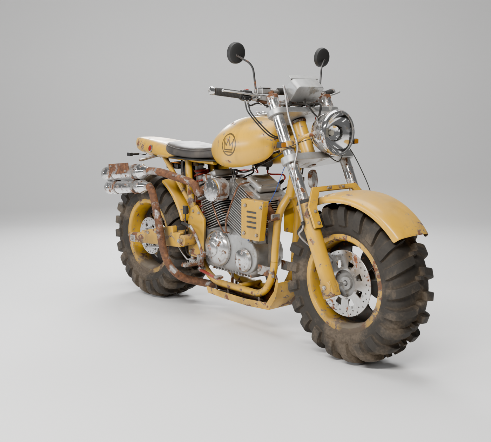
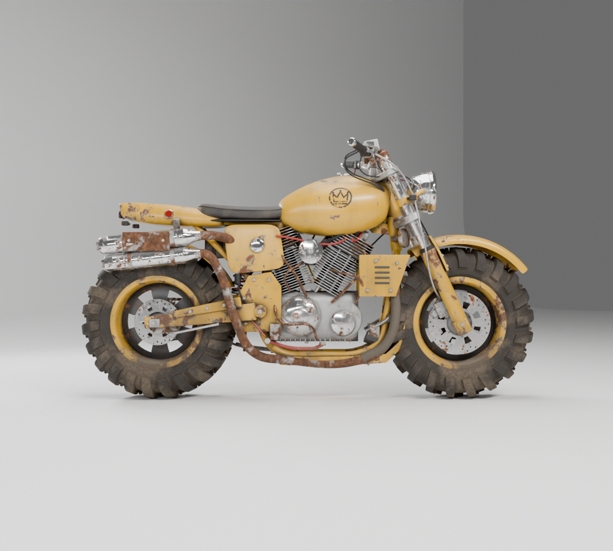
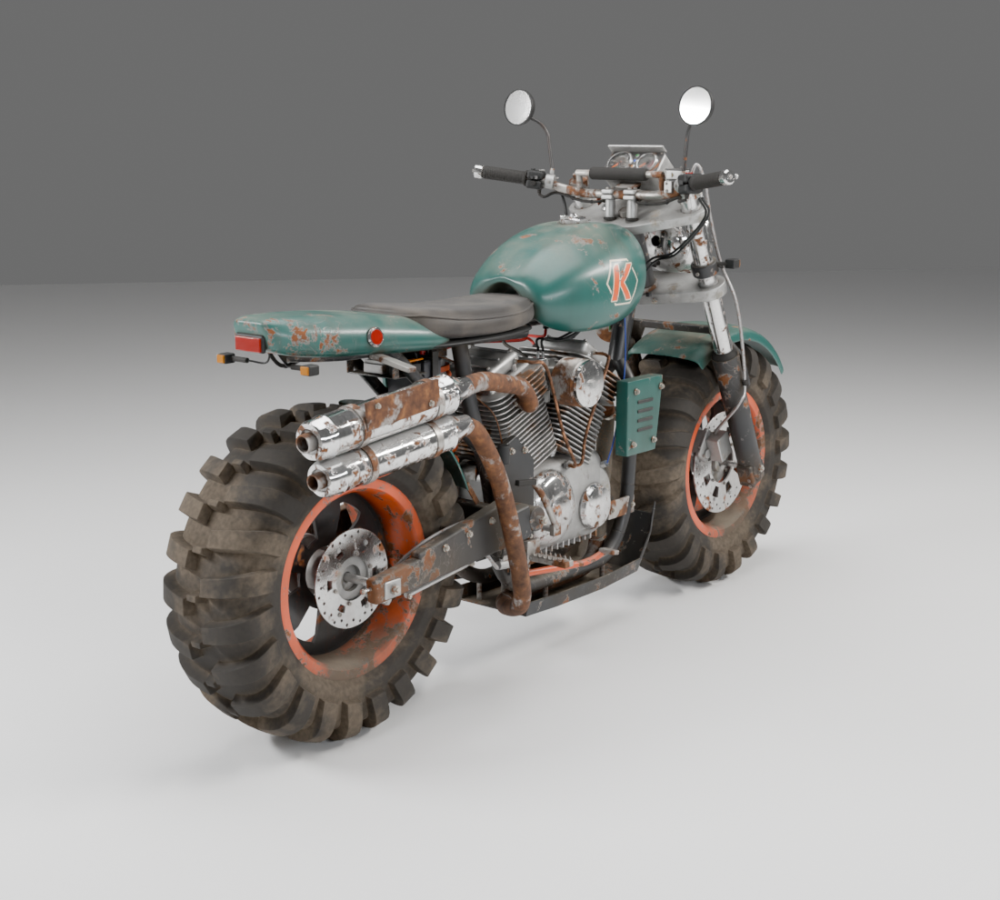
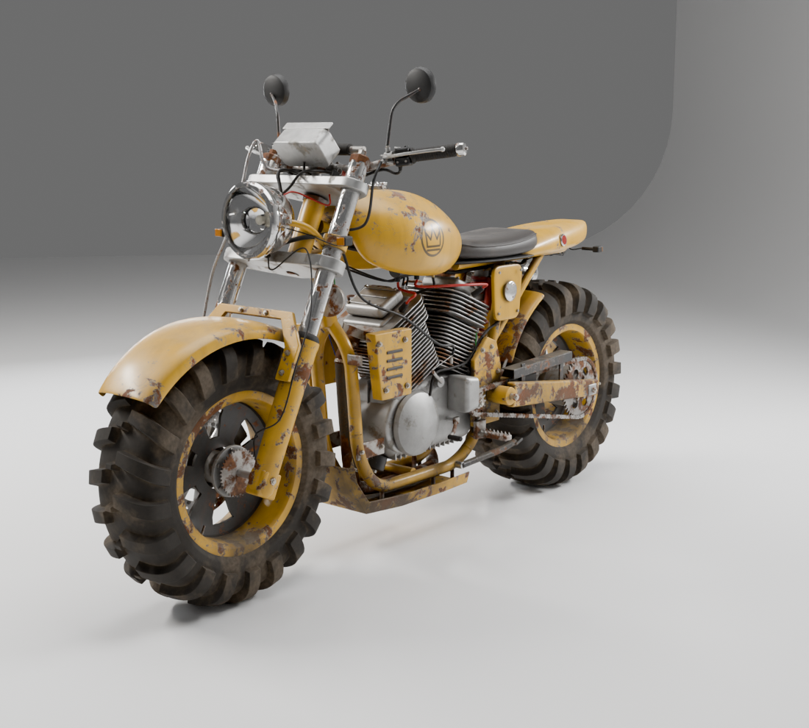
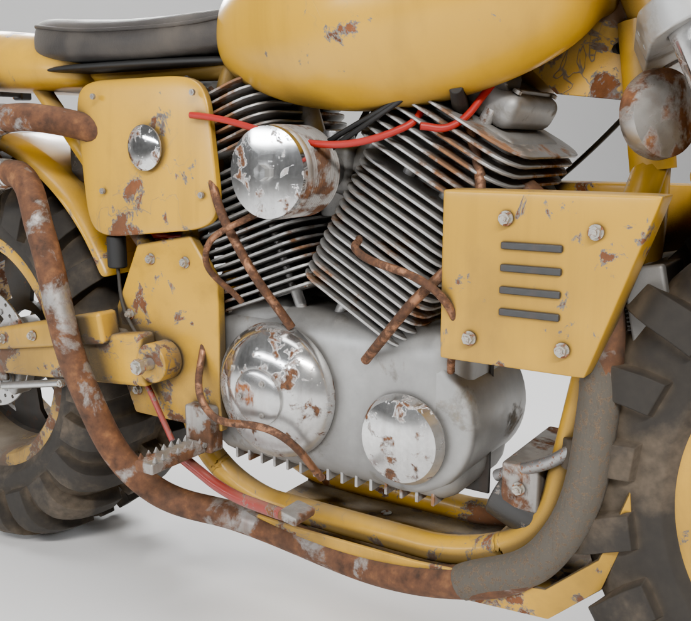

# Wasteland Scrambler — 3D concept bike

A fully procedural, editable Blender model of the yellow "wasteland scrambler" concept
(concept art credit: **@nora.pragmatik**). It is built entirely from Python (`bpy`) so every part
can be re-proportioned, re-detailed or rebuilt, and it ships with game-ready baked exports.



| Side | Rear ¾ | Front ¾ (left) | Engine detail |
|---|---|---|---|
|  |  |  |  |

## What's in the repo

| Path | What it is |
|---|---|
| `bike/wasteland_scrambler.blend` | **Master file (VFX / editing).** Live modifiers, procedural PBR materials, rig, studio + 8 cameras. |
| `exports/wasteland_scrambler.glb` | Game-ready glTF 2.0 binary, baked PBR textures embedded, hierarchy + pivots kept. |
| `exports/wasteland_scrambler.fbx` | Same asset for Unreal / Unity (textures embedded). |
| `exports/wasteland_scrambler.usdc` | USD for VFX pipelines (Houdini, Katana, Omniverse…). |
| `exports/wasteland_scrambler_game.blend` | The baked / modifier-applied game version. |
| `exports/textures/` | 2048² PNG texture sets: `T_{Paint,Metal,Rubber}_{BaseColor,Roughness,Metallic,Normal}`. |
| `scripts/build_bike.py` | Builds the whole bike from scratch (≈2.5k lines, sectioned per sub-assembly). |
| `scripts/render_previews.py` | Renders any of the studio cameras. |
| `scripts/export_game_assets.py` | Applies modifiers, UV-packs, bakes the procedural materials, exports GLB/FBX/USD. |
| `scripts/make_all.sh` | Runs build → previews → bake/export end to end. |

## Asset specs

* **Scale / units:** metres, real-world size: length ≈ 2.1 m, wheelbase 1.46 m, seat height ≈ 0.94 m,
  29" knobby tyres on 17" rims.
* **Orientation:** the bike faces **−Y** in Blender, +Z up, origin on the ground between the axles.
  The glTF exporter converts this to the glTF convention (+Y up, facing +Z).
* **Triangles:** ≈ 335k at the game LOD (modifier viewport levels). Render levels in the master
  file are higher for close-up VFX work.
* **Objects:** ~460 named meshes in collections per sub-assembly — `Frame`, `Bodywork`, `Engine`,
  `Exhaust`, `FrontEnd`, `RearEnd`, `Wheels`, `Controls` — plus `Cutters` (hidden boolean helpers) and
  `Studio` (backdrop, lights, cameras; not part of the asset).
* **Materials (master):** 31 procedural PBR materials with layered wear — paint → primer → bare metal
  → rust → grime (AO-driven) → dust (up-facing) → drip streaks, plus scratches and bump.
  No image textures are needed to render the master file.
* **Materials (game):** 3 baked texture sets (`MAT_Paint`, `MAT_Metal`, `MAT_Rubber`) + a handful of
  flat-colour materials (glass, lenses, wires). The normal maps capture all procedural bump detail.

### Hierarchy and rig

```
Bike_Root                      custom props: steer, fork_travel, swingarm_angle, distance
├─ FrontEnd_SteeringAxis       tilted 25° (rake)
│  └─ FrontEnd_Steer           rotate Z = steering (yokes, stanchions, bars, headlight)
│     └─ FrontEnd_ForkTravel   translate Z = fork compression (sliders, fender, caliper)
│        └─ FrontWheel_Pivot   rotate X = wheel spin
├─ RearEnd_SwingarmPivot       rotate X = rear suspension (swingarm, chain, caliper)
│  └─ RearWheel_Pivot          rotate X = wheel spin
├─ Shock_Upper / Shock_Lower   damped-track constraints keep the monoshock attached,
│                              the spring uses Stretch To
└─ frame, engine, bodywork, exhaust, controls …
```

In the master file the pivots are **driven** by the custom properties on `Bike_Root` (select it →
Object Properties → Custom Properties). `distance` rolls both wheels the correct amount for their radius.
In the exported GLB/FBX the drivers are dropped but the pivot nodes (with clean local transforms) remain,
so they can be animated directly in-engine.

## Editing

Everything is regenerated by one script. Change the parameters at the top of `scripts/build_bike.py`
(`P = dict(...)`: axle positions, rake, fork offset, tyre radius/width/lug count, swingarm pivot,
paint colour), then rebuild:

```bash
blender -b --factory-startup --python scripts/build_bike.py -- --out bike/wasteland_scrambler.blend
```

Non-destructive details you can tweak directly in the master `.blend`:

| Detail | Where |
|---|---|
| Tyre lug count | `*_Tire_Knobs` → *TreadArray* modifier **Count** (a driver keeps the ring at 360°) |
| Knob shape | edit the single knob pitch in `*_Tire_Knobs` (Edit Mode) — the array repeats it |
| Rotor drilling / windows, wheel windows | `*_Cutter` objects in the `Cutters` collection (hidden) + their array counts |
| Cylinder fins | `Engine_*_Fins` → *FinArray* count / offset |
| Tank, seat, tail, panels | low-poly subdivision cages (`Body_*`) — move cage verts, Subdivision does the rest |
| Pipes, frame tubes, cables, hoses | Bézier curves — move points, change *Bevel Depth* for diameter |
| Chain | `Chain_Path` curve + `Chain_Links` (Array + Curve modifiers) |
| Shock spring turns | `Shock_Spring` → *Coil* (Screw) modifier |
| Bolts / nuts | all share 3 meshes (`HW_Bolt_M8`, `HW_CapScrew_M6`, `HW_AxleNut_M16`) — edit one, all update |
| Wear amount | material node trees: ramp thresholds for chips, rust, grime, dust, streaks |

### Using it with Blender MCP

The build script is self-contained: paste `scripts/build_bike.py` into Blender MCP's
`execute_blender_code` (or Blender's Text Editor and press *Run Script*). It clears the current scene
and rebuilds the bike in a few seconds. `build(out_path=None)` is the entry point if you import it as a module.

## Re-baking / re-exporting

```bash
blender -b bike/wasteland_scrambler.blend --python scripts/export_game_assets.py -- \
        --outdir exports --res 4096 --samples 32     # 4K texture sets
```

The source `.blend` is never modified. Use `--skip-bake` to test the pipeline quickly.

**Engine import notes**

* **Unity:** drop in the FBX (or the GLB with glTFast). Set *Scale Factor* 1; materials map to
  URP/HDRP Lit (metallic workflow). Normal maps are OpenGL-style (Y+) — Unity's default.
* **Unreal:** import the FBX with *Convert Scene* on. Normal maps are OpenGL (Y+): tick *Flip Green Channel*
  on the `T_*_Normal` textures.
* **Godot 4 / three.js / Babylon:** use the GLB directly.

## Rebuild everything

```bash
BLENDER=/path/to/blender scripts/make_all.sh      # build -> preview renders -> bake + export
```

Built and tested with Blender 4.5 LTS (works on 4.2+).
