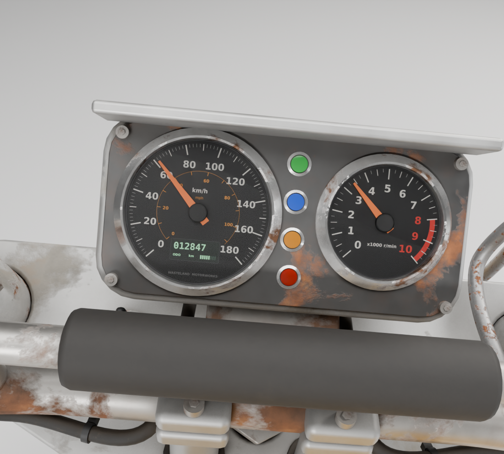
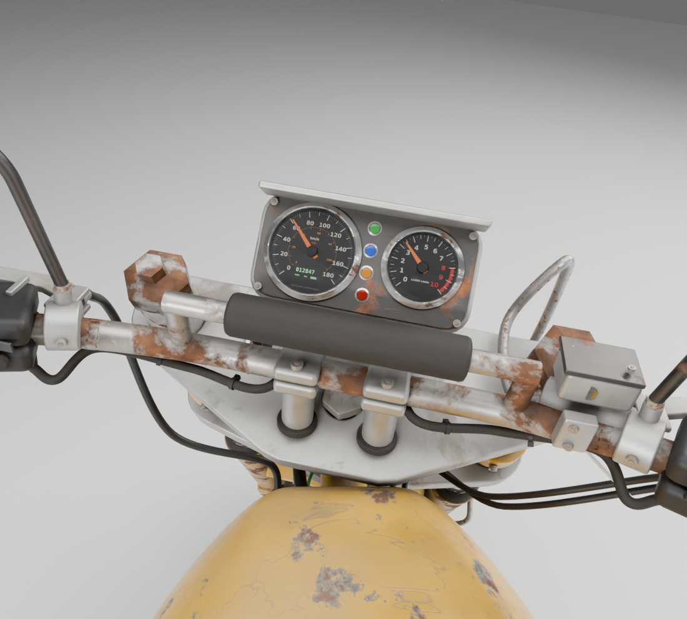
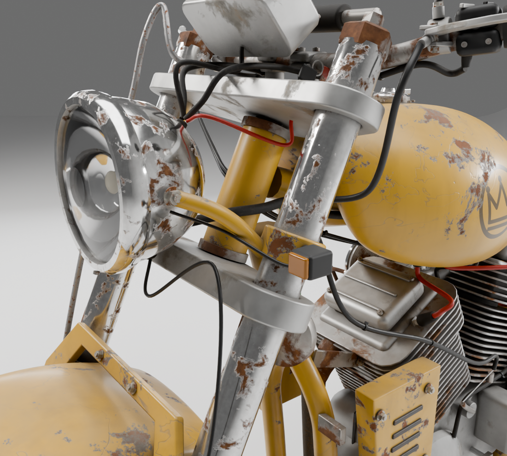
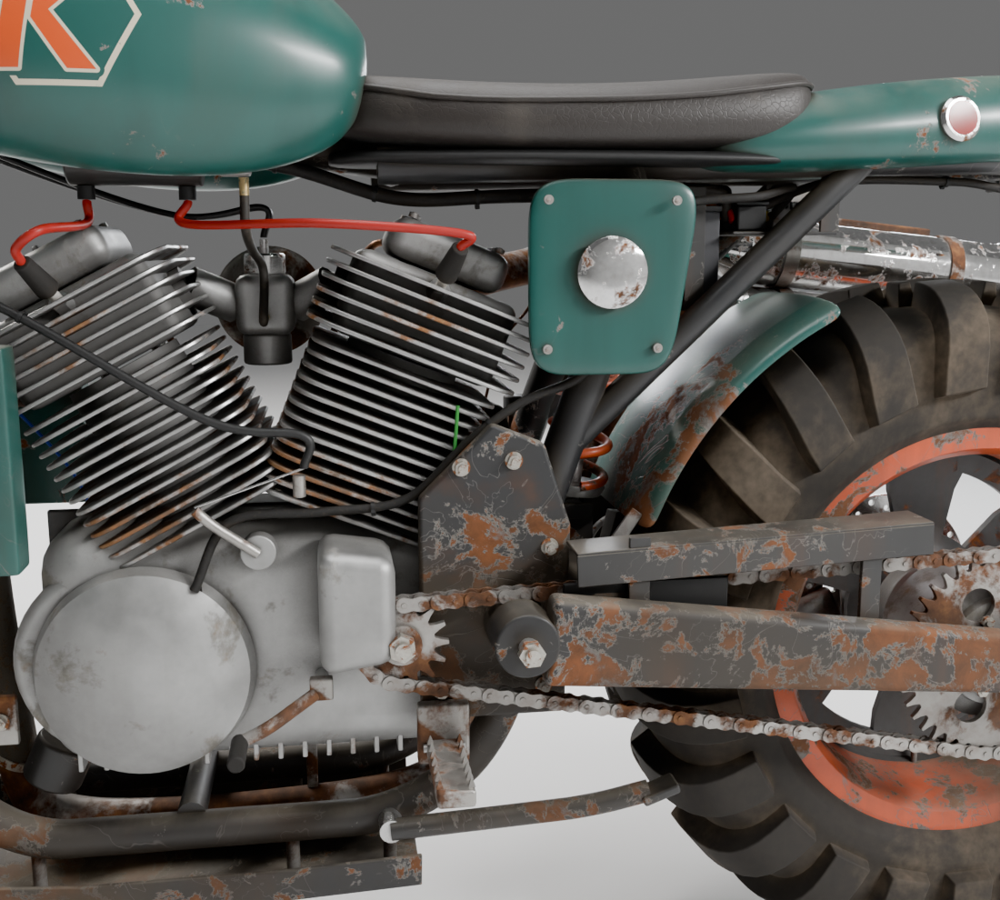
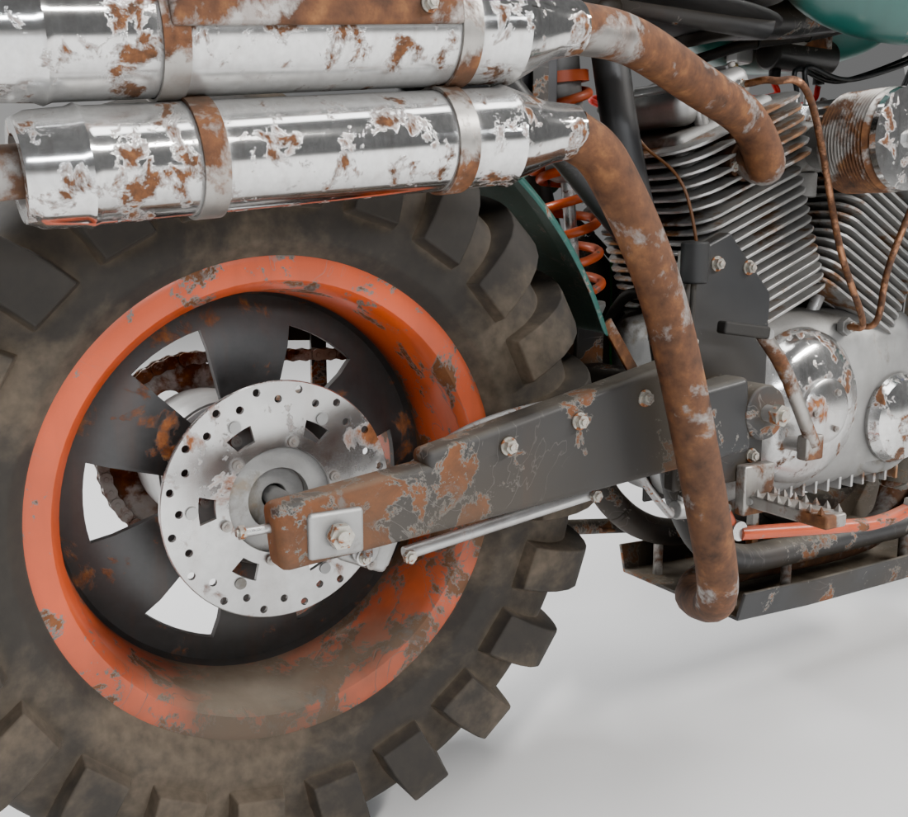

# Wasteland Scrambler — 3D concept bike

A fully procedural, editable Blender model of the yellow "wasteland scrambler" concept
(concept art credit: **@nora.pragmatik**). It is built entirely from Python (`bpy`) so every part
can be re-proportioned, re-detailed or rebuilt, and it ships with game-ready baked exports.
The mechanics are engineered, not just styled: tyres, suspension and steering move through their
full range without touching anything, and every cable and hose is routed, clipped and terminated
at a real component. An automated checker proves it (see [Mechanics](#mechanics)).


| Side | Rear ¾ | Front ¾ (left) | Engine detail |
|---|---|---|---|
|  |  |  |  |

| Gauges | Cockpit (rider's view) | Head stock & harness | Left side: electrics, chain | Rear brake & exhaust |
|---|---|---|---|---|
|  |  |  |  |  |

> **Opening a `.blend`:** both files open in **Material Preview**. If you see a plain grey bike with blank
> gauges, the viewport is in *Solid* shading, which hides textures (dial faces, emblem, rust, wear) —
> press **Z → Material Preview** or use the *Shading* workspace tab.

## What's in the repo

| Path | What it is |
|---|---|
| `bike/wasteland_scrambler.blend` | **Master file (VFX / editing).** Live modifiers, procedural PBR materials, rig, studio + 13 cameras. |
| `bike/textures/` | Printed artwork: speedometer/tachometer dials (+ LCD emission), tank emblem mask. Also packed in the `.blend`. |
| `exports/wasteland_scrambler.glb` | Game-ready glTF 2.0 binary, baked PBR textures embedded, hierarchy + pivots kept. |
| `exports/wasteland_scrambler.fbx` | Same asset for Unreal / Unity (textures embedded). |
| `exports/wasteland_scrambler.usdz` | Self-contained USDZ — opens directly in macOS Quick Look / iOS AR. |
| `exports/wasteland_scrambler.usdc` | USD for VFX pipelines (Houdini, Katana, Omniverse…), textures in `exports/textures/`. |
| `exports/wasteland_scrambler_game.blend` | The baked / modifier-applied game version (texture maps packed in — works on its own). |
| `exports/textures/` | 2048² PNG texture sets: `T_{Paint,Metal,Rubber}_{BaseColor,Roughness,Metallic,Normal}`. |
| `scripts/build_bike.py` | Builds the whole bike from scratch (sectioned per sub-assembly). |
| `scripts/check_mechanics.py` | Sweeps the rig through its range of motion and reports every interference. |
| `scripts/make_textures.py` | Generates the dial faces and emblem artwork (Pillow). |
| `scripts/render_previews.py` | Renders any of the studio cameras (`--set speedo_kmh=62` etc. to pose the rig). |
| `scripts/export_game_assets.py` | Applies modifiers, UV-packs, bakes the procedural materials, exports GLB/FBX/USD/USDZ. |
| `scripts/make_all.sh` | Runs textures → build → mechanics check → previews → bake/export end to end. |

## Asset specs

* **Scale / units:** metres, real-world size: length ≈ 2.2 m, wheelbase 1.56 m, seat height ≈ 0.95 m,
  29" knobby tyres on 17" rims.
* **Orientation:** the bike faces **−Y** in Blender, +Z up, origin on the ground between the axles.
  The glTF exporter converts this to the glTF convention (+Y up, facing +Z).
* **Triangles:** see the export log (≈ 0.4M at the game LOD = modifier viewport levels). Render levels in
  the master file are higher for close-up VFX work.
* **Collections:** `Frame`, `Bodywork`, `Engine`, `Exhaust`, `FrontEnd`, `Cockpit`, `RearEnd`, `Wheels`,
  `Controls`, `Electrics`, `Harness`, plus `Cutters` (hidden boolean helpers) and `Studio` (backdrop, lights,
  cameras; not part of the asset).
* **Materials (master):** procedural PBR with layered wear — paint → primer → bare metal → rust → greasy smudges
  → grime (AO-driven) → dust (up-facing) → drip streaks, plus scratches and bump. Gauges use printed dial textures.
* **Materials (game):** 3 baked texture sets (`MAT_Paint`, `MAT_Metal`, `MAT_Rubber`), the gauge dial textures and a
  handful of flat-colour materials (glass, lenses, wires). The normal maps capture all procedural bump detail.

## Mechanics

The layout is derived from the parts that move, so nothing can rub (`layout()` + `P` in `build_bike.py`):

| | |
|---|---|
| Steering geometry | 25° rake, 50 mm offset → **117 mm trail**; ±35° steering lock with stop bolts on the bottom yoke and lugs on the head tube |
| Front suspension | 120 mm travel along the fork; fender, brace and dust seals clear the bottom yoke at full compression |
| Rear suspension | central monoshock behind the engine; swingarm −6° / +8° ≈ 120 mm wheel travel; shock halves track each other through the travel (Damped Track), spring stretches (Stretch To) |
| Tyre envelopes | real width *including shoulder knobs*; fork legs, chain, swingarm and fenders keep ≥ 12 mm to them; frame cradle, down tube, exhaust and shrouds sit outside the front tyre's envelope swept through full compression **and** full lock |
| Final drive | chain line at x ≈ 159 mm (outside the fat rear tyre) on a cush-drive sprocket carrier; chain slider and guard on the swingarm |
| Brakes | two-piece calipers straddle the rotors (pads either side, bridge outside the disc edge); front hose runs in front of the yokes to a guide on the slider; rear master cylinder under the right pivot plate with remote reservoir |
| Engine | air-cooled 50° V-twin, kick start, wet sump; front exhaust port forward, rear port on the right flank; external rocker oil feeds with banjo fittings; carb in the V with pod filter; twin-tower coil under the tank |
| Electrics | battery → fuse box → main loom along the backbone (inside the tank tunnel) → head stock → headlight shell junction → switchgear / gauges / ignition. Rear loom to the tail; alternator → regulator/rectifier; CDI, flasher relay, ground lug; neutral, oil-pressure and brake-light switches all wired. Looms are tied with shared-mesh cable ties |
| Flexible lines | throttle, clutch, brake and speed-sensor lines and the main loom flex with steering and suspension through **Hook** modifiers bound to the rig pivots |

### Checking it

```bash
blender -b bike/wasteland_scrambler.blend --python scripts/check_mechanics.py -- --static --lines
```

* **motion** — sweeps steering lock, fork travel and swingarm travel (and combinations) and tests every moving
  assembly (front wheel, unsprung front, steered parts, rear wheel, swingarm) against everything it must not touch.
* `--static` — interferences between static parts (pipes through frame tubes, wires through solid parts…).
* `--lines` — re-tests every cable/hose/loom in every pose, so the flexing lines are checked too.

Intended contacts (bolts in their holes, the stanchion in its slider, a hose in its fitting …) are whitelisted in
the script. The committed model reports **0 / 0 / 0**.

### Hierarchy and rig

```
Bike_Root                      custom props: steer, fork_travel, swingarm_angle, distance, speedo_kmh, tacho_rpm
├─ FrontEnd_SteeringAxis       tilted 25° (rake)
│  └─ FrontEnd_Steer           rotate Z = steering (yokes, stanchions, bars, cockpit, headlight)
│     ├─ Gauge_*_NeedlePivot   needles rotate local Z (driven by speedo_kmh / tacho_rpm)
│     └─ FrontEnd_ForkTravel   translate Z = fork compression (sliders, fender, caliper, speed sensor)
│        └─ FrontWheel_Pivot   rotate X = wheel spin
├─ RearEnd_SwingarmPivot       rotate X = rear suspension (swingarm, chain, caliper, hugger)
│  └─ RearWheel_Pivot          rotate X = wheel spin
├─ Shock_Upper / Shock_Lower   constraints keep the monoshock attached through the travel
└─ frame, engine, bodywork, exhaust, controls, electrics, harness …
```

In the master file the pivots are **driven** by the custom properties on `Bike_Root` (select it →
Object Properties → Custom Properties); the ranges are the real mechanical limits. `distance` rolls both
wheels the correct amount for their radius. In the exported GLB/FBX the drivers are dropped but the pivot nodes
(with clean local transforms) remain, so they can be animated directly in-engine.

## Editing

Everything is regenerated by one script. Change the parameters at the top of `scripts/build_bike.py`
(`P = dict(...)`: axle positions, rake, offset, yoke positions, steering lock, suspension travel, tyre
radius/width/lug count, swingarm pivot, paint colour), rebuild, then re-run the checker:

```bash
python3 scripts/make_textures.py
blender -b --factory-startup --python scripts/build_bike.py -- --out bike/wasteland_scrambler.blend
blender -b bike/wasteland_scrambler.blend --python scripts/check_mechanics.py -- --static --lines
```

Non-destructive details you can tweak directly in the master `.blend`:

| Detail | Where |
|---|---|
| Tyre lug count | `*_Tire_Knobs` → *TreadArray* modifier **Count** (a driver keeps the ring at 360°) |
| Knob shape | edit the single knob pitch in `*_Tire_Knobs` (Edit Mode) — the array repeats it |
| Rotor drilling / windows, wheel windows | `*_Cutter` objects in the `Cutters` collection (hidden) + their array counts |
| Cylinder fins | `Engine_*_Fins` → *FinArray* count / offset |
| Tank, seat, tail, covers | low-poly subdivision cages (`Body_*`) — move cage verts, Subdivision does the rest |
| Pipes, frame tubes, cables, hoses, looms | Bézier curves — move points, change *Bevel Depth* for diameter; flexing lines carry `Flex_*` Hook modifiers |
| Chain | `Chain_Path` curve + `Chain_Links` (Array + Curve modifiers) |
| Shock spring turns | `Shock_Spring` → *Coil* (Screw) modifier |
| Bolts, nuts, cable ties | shared meshes (`HW_Bolt_M8`, `HW_CapScrew_M6`, `HW_AxleNut_M16`, `HW_CableTie_*`) — edit one, all update |
| Tank emblem | `bike/textures/emblem_crown_mask.png` projected in `M_Paint_Yellow_Tank` (under the wear layers) |
| Dial artwork | `scripts/make_textures.py` → `bike/textures/dial_*.png` |
| Wear amount | material node trees: ramp thresholds for chips, rust, grime, dust, streaks |

### Using it with Blender MCP

The build script is self-contained: paste `scripts/build_bike.py` into Blender MCP's
`execute_blender_code` (or Blender's Text Editor and press *Run Script*). Set the environment variable
`BIKE_TEXDIR` (or edit `TEXDIR`) to the `bike/textures` folder so the dial/emblem artwork is found.
It clears the current scene and rebuilds the bike in a few seconds. `build(out_path=None)` is the entry point.

## Re-baking / re-exporting

```bash
blender -b bike/wasteland_scrambler.blend --python scripts/export_game_assets.py -- \
        --outdir exports --res 4096 --samples 32     # 4K texture sets
```

The source `.blend` is never modified. Use `--skip-bake` to test the pipeline quickly, and `--resume` to
carry on an interrupted bake (maps already in `<outdir>/textures` are reused; the UV unwrap is deterministic).
After editing the game version (LODs, texture paint-overs…), write the files again without re-baking:

```bash
blender -b exports/wasteland_scrambler_game.blend --python scripts/export_game_assets.py -- \
        --outdir exports --reexport            # optionally --formats glb,fbx,usd,usdz,blend
```

**Engine import notes**

* **Unity:** drop in the FBX (or the GLB with glTFast). Set *Scale Factor* 1; materials map to
  URP/HDRP Lit (metallic workflow). Normal maps are OpenGL-style (Y+) — Unity's default.
* **Unreal:** import the FBX with *Convert Scene* on. Normal maps are OpenGL (Y+): tick *Flip Green Channel*
  on the `T_*_Normal` textures.
* **Godot 4 / three.js / Babylon:** use the GLB directly.
* **Apple (Quick Look, Reality Composer, AR):** use the USDZ.

## Rebuild everything

```bash
BLENDER=/path/to/blender scripts/make_all.sh      # textures -> build -> check -> previews -> bake + export
```

Built and tested with Blender 4.5 LTS (works on 4.2+).
